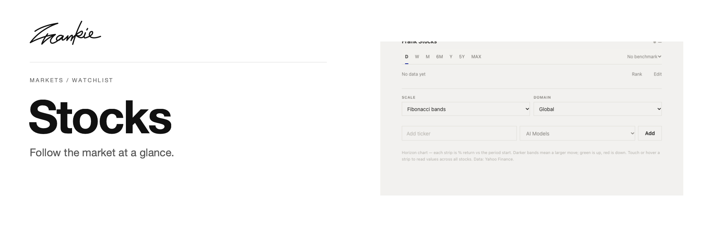

# Frank Stocks

A stock watchlist and return dashboard built with TanStack Start, React and D3.

## Features

- Organize stock symbols into thematic watchlist groups.
- Compare price history and return horizons with SVG charts.
- Change periods, scales and optional benchmark comparisons.

## Getting started

```sh
npm ci
npm run dev
```

Open the local URL printed by Vite.

## Project notes

The watchlist is stored in `watchlist.json`; the app uses local server routes for market data. Chart periods and benchmark choices are exposed in the UI.

## Development

```sh
npm run build
npm run preview
npm start
```

`price_cache.json` is generated at runtime and ignored by Git.

Banner sources and update instructions: [README artwork](docs/readme/README.md).
