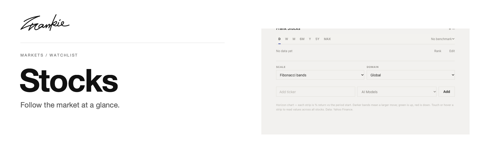

# Frank Stocks

[English](README.md) · [简体中文](README.zh-CN.md)

按主题整理自选股，比较它们在不同时段的变化。

[介绍页](https://songhaifan.github.io/frankie-stocks/zh/) · [项目指南](docs/guide.md) · [本地运行](#本地运行)

## 可以做什么

- 根据关注的主题整理股票代码。
- 使用 SVG 图表比较历史价格与不同周期的收益。
- 切换时段、刻度与基准比较。

## 本地运行

```sh
npm ci
npm run dev
```

打开 Vite 输出的本地地址。

## 开始之前

本地自选列表位于 `watchlist.json`。行情数据通过服务端路由获取，`price_cache.json` 为生成的缓存。可显示的图表取决于数据源返回的内容。

## 开发说明

```sh
npm run build
npm run preview
npm start
```

[项目指南](docs/guide.md) · [Banner 维护](docs/readme/README.md)

---

由 [Songhai Fan](https://github.com/SonghaiFan) 制作 · Frankie 系列项目
